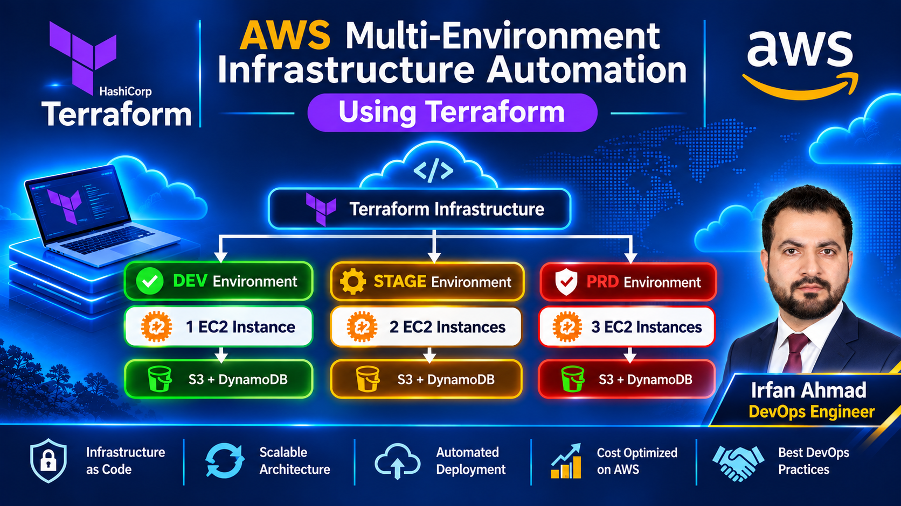
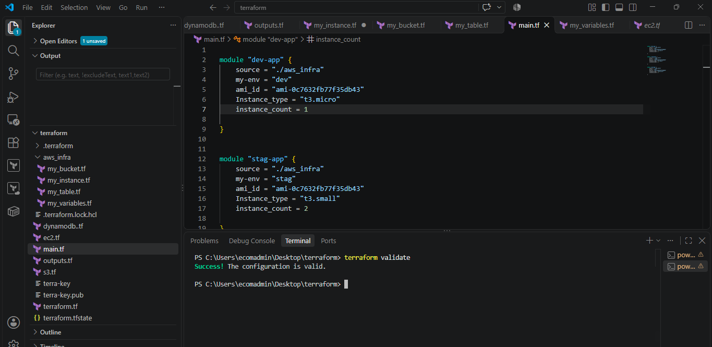
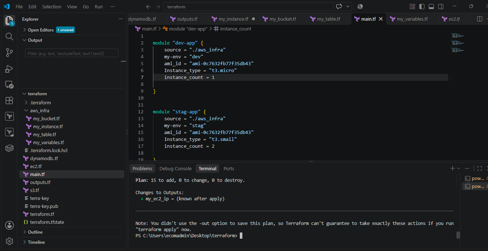
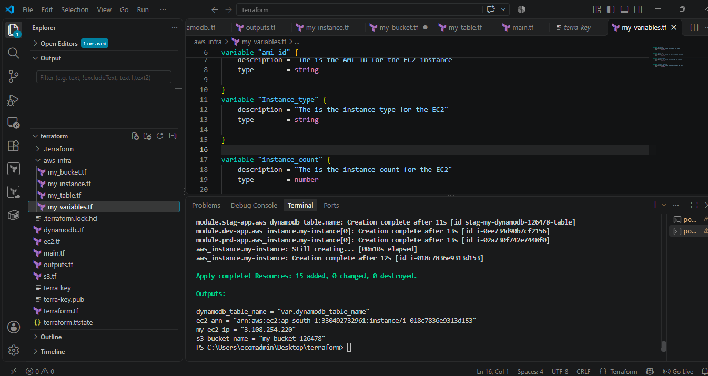
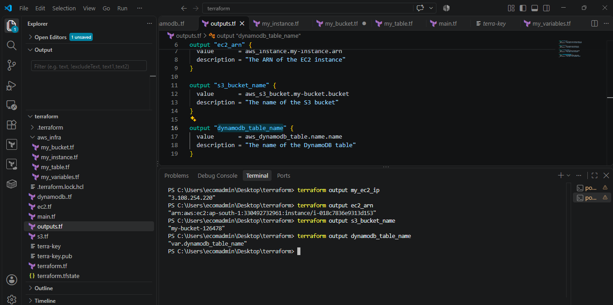
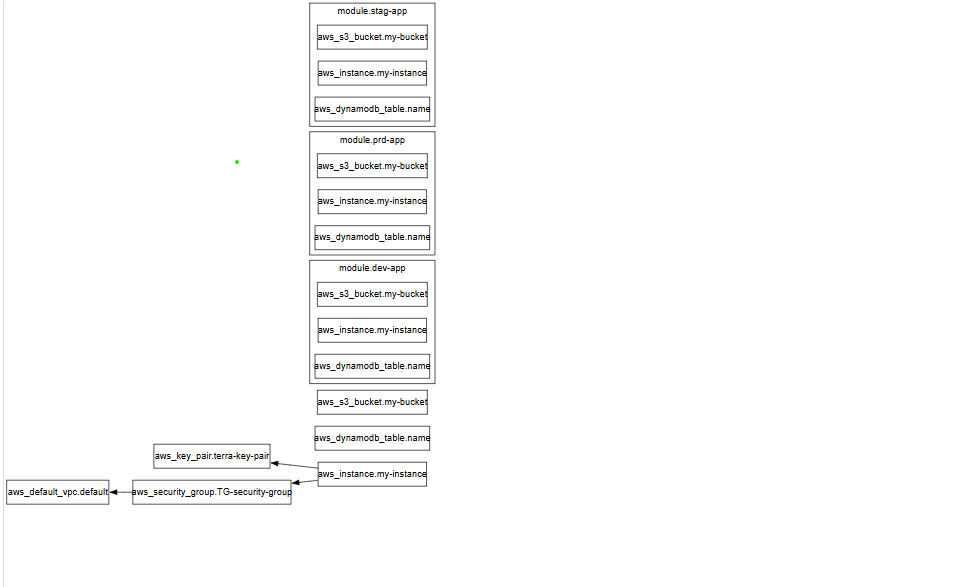
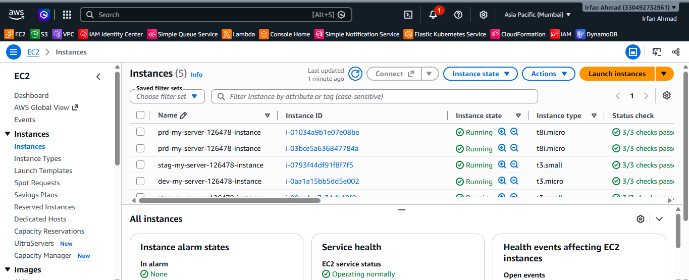
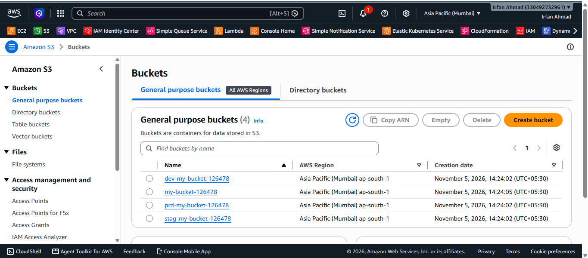
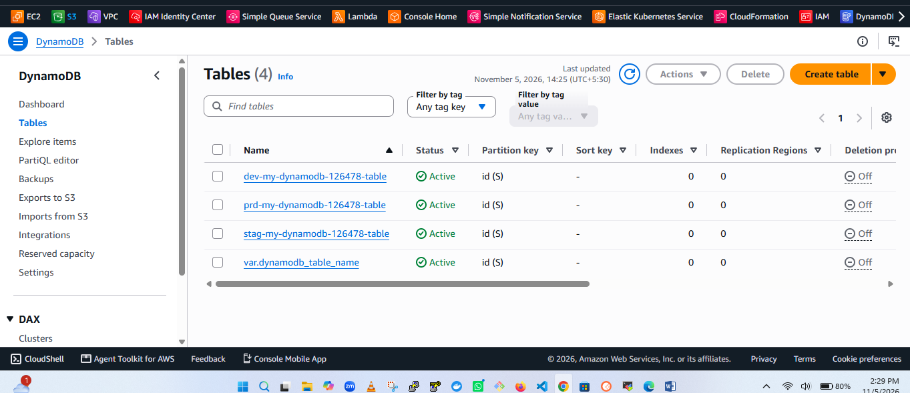

# AWS Multi-Environment Infrastructure Automation Using Terraform

<p align="center">
  
</p>

<p align="center">
  <strong>Infrastructure as Code | AWS | Terraform | DevOps</strong>
</p>

<p align="center">
  
  
  
  
  
</p>

## Project Overview

This project demonstrates the automation of AWS infrastructure provisioning using **Terraform Infrastructure as Code (IaC)**.

The objective is to create and manage infrastructure across three different environments:

- Development (DEV)
- Staging (STAGE)
- Production (PRD)

The project uses reusable Terraform modules to simplify infrastructure management, reduce configuration duplication, and maintain consistency across environments.

Instead of manually provisioning resources through the AWS Management Console, infrastructure is defined using Terraform HCL configuration files and deployed through automated Terraform workflows.

## Architecture Overview

<p align="center">
  
</p>

*Conceptual architecture of the multi-environment deployment.*

## AWS Services Used

| AWS Service | Purpose |
|---|---|
| Amazon EC2 | Virtual machine provisioning |
| Amazon S3 | Object storage and bucket management |
| Amazon DynamoDB | NoSQL database table provisioning |
| AWS IAM | Access and permissions management |
| AWS Provider | Terraform integration with AWS |

## Tools and Technologies

| Tool | Usage |
|---|---|
| Terraform | Infrastructure as Code |
| HCL | Terraform configuration language |
| AWS | Cloud infrastructure |
| Visual Studio Code | Configuration development |
| PowerShell | Executing Terraform commands |
| Git | Version control |
| GitHub | Source code repository |
| Graphviz | Terraform dependency graph visualization |

## Project Directory Structure

```text
terraform-aws-multi-environment-infrastructure/
│
├── aws_infra/
│   ├── my_bucket.tf
│   ├── my_instance.tf
│   ├── my_table.tf
│   └── my_variables.tf
│
├── screenshots/
│   ├── terraform-plan.png
│   ├── terraform-validate.png
│   ├── terraform-apply.png
│   ├── terraform-outputs.png
│   ├── terraform-graph.png
│   ├── aws-ec2-instances.png
│   ├── aws-s3-bucket.png
│   └── aws-dynamodb.png
│
├── main.tf
├── ec2.tf
├── s3.tf
├── dynamodb.tf
├── variables.tf
├── outputs.tf
├── terraform.tf
├── .gitignore
├── .terraform.lock.hcl
└── README.md
```


## Terraform Implementation

### 1. Terraform Initialization

Download the required providers and initialize the working directory.

```powershell
terraform init
```

### 2. Format Terraform Configuration

```powershell
terraform fmt -recursive
```

### 3. Validate Configuration

Check Terraform configuration syntax and internal consistency.

```powershell
terraform validate
```

### 4. Generate Execution Plan

Review the infrastructure changes before deployment.

```powershell
terraform plan
```

### 5. Deploy Infrastructure

```powershell
terraform apply
```

Review the proposed changes and confirm with `yes` when appropriate.

### 6. Retrieve Terraform Outputs

Display all configured outputs:

```powershell
terraform output
```

Retrieve individual outputs:

```powershell
terraform output my_ec2_ip
terraform output ec2_arn
terraform output s3_bucket_name
terraform output dynamodb_table_name
```

### 7. Inspect Terraform State

List managed resources:

```powershell
terraform state list
```

Inspect a specific resource:

```powershell
terraform state show aws_instance.my-instance
```

### 8. Destroy all infrastructure managed by this configuration
```powershell
terraform destroy
```

**Important: terraform destroy destroys all resources managed by the current Terraform configuration and state. Review the destruction plan carefully and confirm only when you are sure you want to remove the infrastructure**

### 9. Generate Infrastructure Dependency Graph

```powershell
terraform graph > graph.dot
```

## Project Screenshots

### Terraform Workflow

**Terraform Validation**



**Terraform Execution Plan**



**Terraform Apply**



**Terraform Outputs**



**Terraform Infrastructure Dependency Graph**



### AWS Infrastructure

**EC2 Instances**



**Amazon S3**



**Amazon DynamoDB**



## Key Features

- Multi-environment infrastructure provisioning.
- DEV, STAGE and PRD environment separation.
- Reusable Terraform module architecture.
- AWS EC2 instance provisioning.
- Amazon S3 bucket provisioning.
- Amazon DynamoDB table provisioning.
- Input variables and output management.
- Terraform infrastructure dependency visualization.
- Infrastructure lifecycle management.
- Configuration validation and execution planning.

## Challenges and Troubleshooting

During implementation, I worked on resolving practical Terraform and AWS issues, including:

- Correcting Terraform variable references.
- Resolving unsupported module arguments.
- Troubleshooting invalid AMI and EC2 instance type values.
- Understanding Terraform validation versus AWS runtime errors.
- Handling AWS EC2 vCPU service quota limitations.
- Managing partially successful Terraform deployments.
- Understanding Terraform state and resource outputs.

## Security and Best Practices

- Never commit AWS access keys or secret credentials.
- Exclude Terraform state files from public repositories.
- Exclude sensitive `.tfvars` files.
- Keep `.terraform.lock.hcl` under version control.
- Use IAM roles or securely configured AWS credentials.
- Review execution plans before applying changes.
- Use meaningful resource names and environment tags.
- Consider remote state storage and locking for team environments.

## Learning Outcomes

This project provided practical experience in:

1. Infrastructure as Code using Terraform.
2. AWS infrastructure provisioning and management.
3. Reusable Terraform modules.
4. Multi-environment architecture.
5. Terraform variables, outputs and state management.
6. Infrastructure dependency visualization.
7. AWS quota troubleshooting.
8. Git and GitHub project management.

## Author

**Irfan Ahmad**  
**DevOps Engineer**

## 🔗 Project Repository

**GitHub:** [AWS Multi-Environment Infrastructure Automation Using Terraform](https://github.com/Irfan-devops1/terraform-aws-multi-environment-infrastructure-Project)

**Technical Skills:** AWS | Azure | Terraform | Jenkins | Docker | Kubernetes | Ansible | Helm | GitOps | DevSecOps | Prometheus | Grafana

---

If you find this project useful, please consider giving this repository a ⭐.

